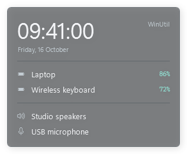
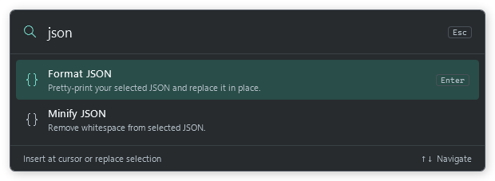
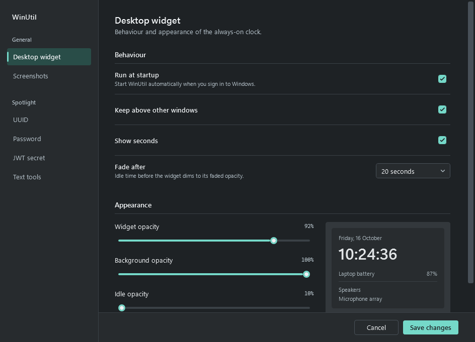
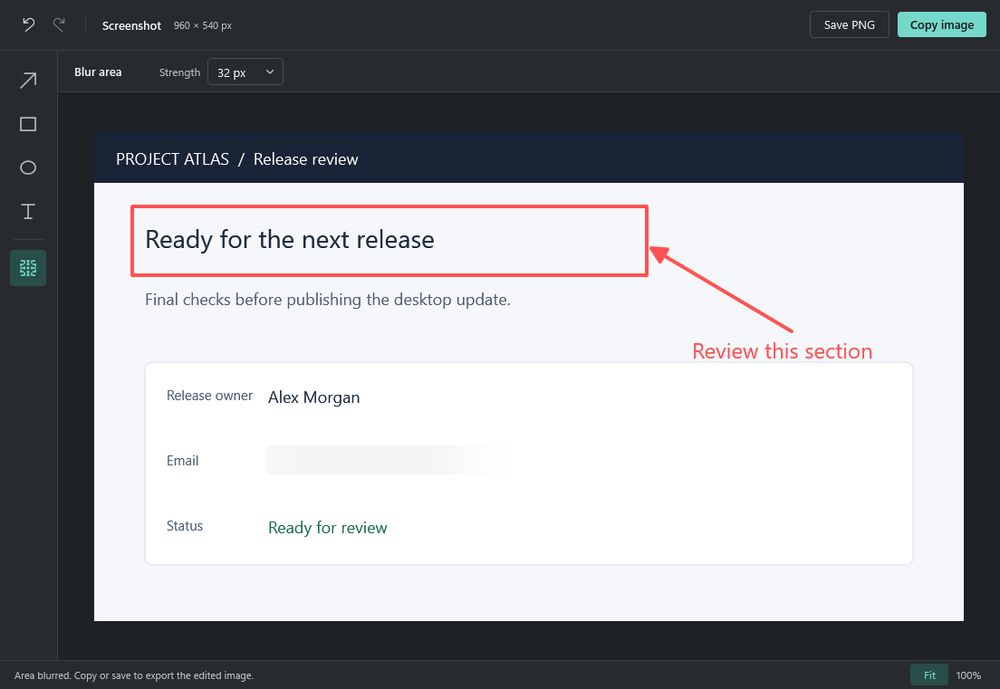

# WinUtil

Windows desktop widget and Spotlight utilities. Requires Windows 10 or later (x64).

## Screenshots

Captured from the native Windows UI with sample device and editor data.

### Desktop widget



### Spotlight



### Settings



### Screenshot editor



## Install

Run `artifacts\installer\WinUtil-Setup-1.0.0-win-x64.exe` after building. Setup installs for the current user, adds a Start menu shortcut, and configures launch at Windows sign-in. The .NET runtime is included; administrator access is not required.

Change **Settings → Desktop widget → Run at startup** and save to enable or disable launch at sign-in. Upgrades preserve this preference. Exit WinUtil from its tray menu before upgrading or uninstalling. Uninstall through Windows Settings → Apps; saved app preferences remain in `%APPDATA%\WinUtil`.

## Screenshot editor

While WinUtil is running, press **Win+Shift+S** and capture a screenshot. The image opens in WinUtil with arrow, rectangle, ellipse, text, and selected-area blur tools. Use Undo/Redo, copy the edited image, or save it as a PNG. Copy and save flatten the edits into the image at the original resolution.

Choose a tool from the left rail; its colour, line width, text size, or blur strength appears above the canvas. With Text selected, click the image and type in place. Press **Ctrl+Enter** to place the text or **Esc** to cancel it. Use **Fit** to see the whole screenshot or **100%** to inspect and scroll its pixels.

Automatic opening can be changed in **Settings → Screenshots**. Cancelled snips and ordinary copied images do not open the editor. Editor colour, line width, text size, and blur strength are remembered when the editor closes.

## Build

Install the .NET 9 SDK and [Inno Setup 6 or 7](https://jrsoftware.org/isdl.php), then run from PowerShell:

```powershell
.\scripts\build-installer.ps1
```

For a custom compiler location:

```powershell
.\scripts\build-installer.ps1 -InnoSetupCompiler 'C:\Tools\Inno Setup\ISCC.exe'
```

The script runs the test suite, publishes a self-contained single EXE to `artifacts\publish\win-x64\WinUtil.exe`, and builds the versioned installer in `artifacts\installer`. Generated artifacts are ignored by Git.

To run only the tests or publish only the portable EXE:

```powershell
dotnet run --project .\WinUtil.Tests\WinUtil.Tests.csproj --configuration Release
dotnet publish .\WinUtil.csproj --configuration Release -p:PublishProfile=win-x64 --source https://api.nuget.org/v3/index.json
```
